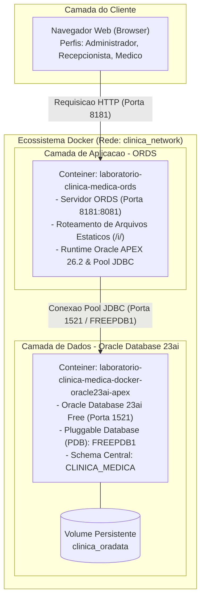

# SmartDB Clínica Médica

Sistema transacional de gestão hospitalar e clínica desenvolvido com **Oracle APEX** e **Oracle Database 23ai**. O projeto foca em arquitetura de dados relacional de alta integridade, governança de acessos baseada em funções (RBAC), conformidade com a LGPD e automação completa de infraestrutura como código (IaC) via Docker.

## Documentação Rápida
- [Guia de Execução Local (IaC)](COMO_EXECUTAR.md): Instruções passo a passo para inicialização do ecossistema Docker, orquestração e cargas de dados.
- [Regras de Negócio e Arquitetura de Dados](REGRAS_DE_NEGOCIO.md): Especificação das regras de integridade, modelo relacional (DER), automações PL/SQL e auditoria.

## Arquitetura do Ecossistema

O ambiente é 100% conteinerizado e provisionado via Docker Compose sobre a rede dedicada `clinica_network`, garantindo isolamento entre serviços, roteamento de estáticos e persistência dos dados físicos.

## Entregas Técnicas do Projeto

O ecossistema é composto por 13 tabelas físicas e 2 views de negócio, orquestradas através de contêineres Docker para garantir a reprodutibilidade do ambiente de banco de dados.

* **Modelagem de Dados:** Estruturação relacional com chaves primárias artificiais (`IDENTITY`), chaves de negócio (`CPF`, `CRM`, `CNPJ`), integridade referencial e constraints de domínio.
* **Segurança e Governança (RBAC):** Implementação de Controle de Acesso Baseado em Funções com autenticação customizada em banco e esquemas de autorização desacoplados.
* **Isolamento de Visão:** Segregação estrita de interface no Oracle APEX garantindo que perfis distintos (Administrador, Médico e Recepcionista) acessem apenas seus respectivos domínios.
* **Infraestrutura como Código (IaC):** Scripts de inicialização (`orquestrador.sh`) e DDL/DML versionados para carga automatizada do ambiente.

## Stack Tecnológico

* Oracle Database 23ai (Docker Free Edition)
* Oracle APEX 26.2
* Oracle REST Data Services (ORDS 26.3)
* PL/SQL
* Shell Script / Bash
* Docker & Docker Compose

## Estrutura de Diretórios

* `backend/dicionario_de_dados/`: Documentação de requisitos, modelagem, roteiros de telas e matriz de segurança.
* `backend/scripts_banco/`: Scripts DDL para criação de tabelas, views e automação de login customizado.
* `backend/scripts_orquestracao/`: Scripts de orquestração automatizada e instalação do APEX no banco.
* `docker-compose.yml`: Definição dos serviços de banco e ORDS com redes e volumes persistentes.

## Autor
Desenvolvido por Arley Ribeiro - Database Administrator.
