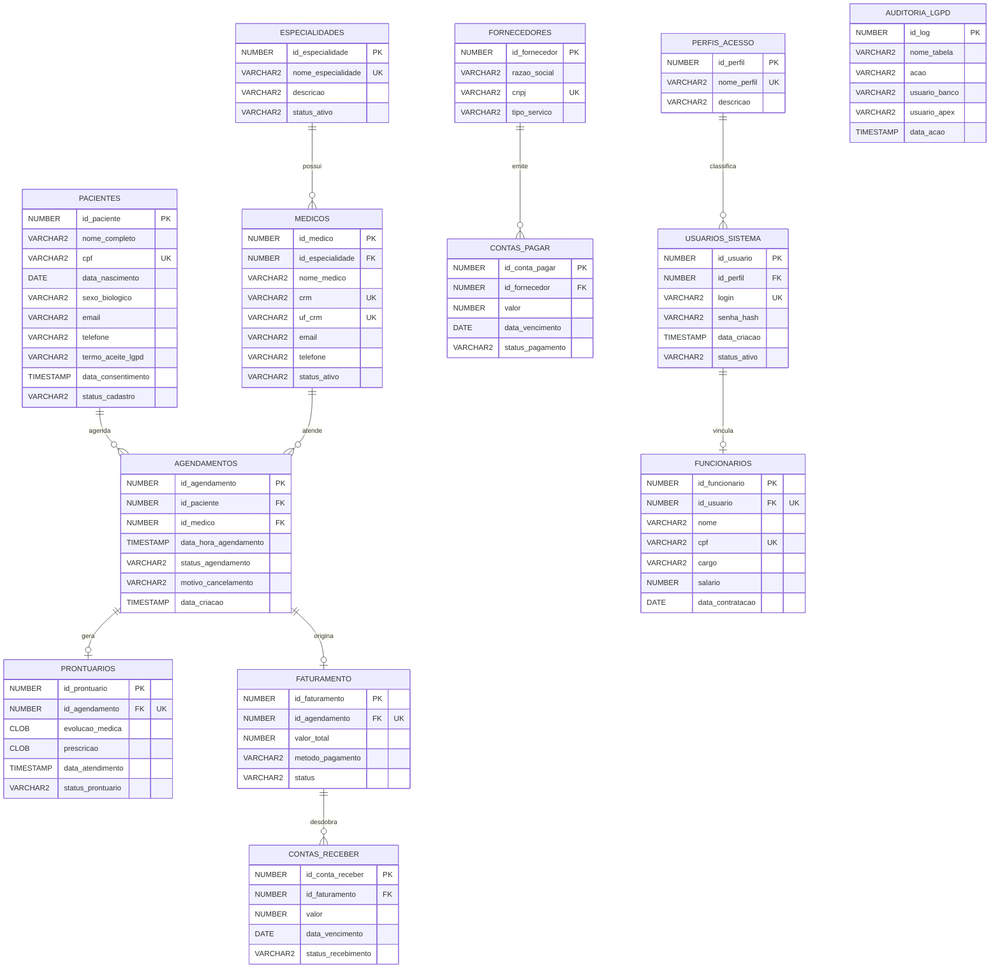

# Documento de Arquitetura de Dados e Regras de Negocio

**Sistema:** SmartDB Clinica Medica  
**SGBD:** Oracle Database 23ai Enterprise / Free Edition  
**Framework de Aplicacao:** Oracle APEX 24.x / 26.x e Oracle REST Data Services (ORDS)  
**Schema Central:** `CLINICA_MEDICA`  
**Status do Escopo:** Congelado (Baseline Versao 1.0)  

---

## A. Visao Executiva do Dominio

O **SmartDB Clinica Medica** e uma plataforma corporativa transacional (OLTP) projetada para a gestao integrada de unidades ambulatoriais e centros medicos de medio e grande porte. A arquitetura foi desenvolvida sobre o motor relacional do **Oracle Database 23ai**, priorizando alta integridade referencial, conformidade regulatoria rigorosa (LGPD e CFM) e isolamento operacional por papeis de acesso (RBAC).

O ecossistema e estruturado em 3 macro-modulos funcionais:

```
+-----------------------------------------------------------------------------------+
|                           SMARTDB CLINICA MEDICA                                  |
+-----------------------------------------------------------------------------------+
|                                                                                   |
|  [ MODULO 1: CLINICO E ATENDIMENTO ]                                              |
|  - Cadastro e consentimento de Pacientes (LGPD)                                    |
|  - Catalogo de Especialidades e Corpo Clinico (Medicos)                           |
|  - Agendamentos e controle de consultas ambulatoriais                             |
|  - Prontuarios Eletronicos do Paciente (PEP - Evolucao e Prescricao)              |
|                                                                                   |
|  [ MODULO 2: ADMINISTRATIVO E FINANCEIRO (BACK-OFFICE) ]                          |
|  - Homologacao e gestao de Fornecedores de insumos hospitalares                   |
|  - Contas a Pagar (Obrigacoes operacionais e insumos medicos)                     |
|  - Faturamento consolidado por atendimento realizado                              |
|  - Contas a Receber (Gestao de titulos, liquidacao e inadimplencia)               |
|  - Quadro de Colaboradores (Recursos Humanos) com salarios restritos              |
|                                                                                   |
|  [ MODULO 3: GOVERNANCA, SEGURANCA E RBAC ]                                       |
|  - Perfis de Acesso e Contas de Login segregadas                                  |
|  - Funcao customizada de autenticacao de sessao                                   |
|  - Trilha imutavel de auditoria LGPD com captura de contexto APEX                 |
|  - Rotinas automaticas agendadas (Oracle Scheduler)                               |
+-----------------------------------------------------------------------------------+
```

---

## B. Regras Estruturais e Integridade Relacional (Tabelas e Constraints)

A modelagem de dados foi desenhada com governanca estrita no nivel de banco de dados, utilizando chaves primarias artificiais imutaveis (`GENERATED ALWAYS AS IDENTITY`), chaves candidatas naturais protegidas por indices de unicidade e restricoes de dominio (`CHECK`) para impedir a persistencia de estados invalidos.

### 1. Diagrama Entidade-Relacionamento (DER)

O diagrama abaixo mapeia as 13 tabelas fisicas do schema `CLINICA_MEDICA`, seus atributos estruturais, identificadores primarios (`PK`), estrangeiros (`FK`), de unicidade (`UK`) e as respectivas cardinalidades relacionais do sistema:



### 2. Unicidade e Identificadores Naturais (Unique Constraints)
- **`UK_PACIENTES_CPF` (`PACIENTES.CPF`):** Garante a unicidade cadastral do paciente na instituicao. Impede duplicidade de prontuarios para o mesmo titular civil.
- **`UK_MEDICOS_CRM_UF` (`MEDICOS.CRM`, `MEDICOS.UF_CRM`):** Restricao composta de unicidade. Permite que um mesmo numero ordinal de CRM exista em conselhos regionais de estados distintos (ex: SP e RJ), mas impede duplicidade de medicos na mesma unidade federativa.
- **`UK_FORNECEDORES_CNPJ` (`FORNECEDORES.CNPJ`):** Unicidade do Cadastro Nacional da Pessoa Juridica para parceiros e distribuidoras de medicamentos.
- **`UK_ESPECIALIDADES_NOME` (`ESPECIALIDADES.NOME_ESPECIALIDADE`):** Impede o cadastramento de especialidades medicas homonimas.
- **`UK_PERFIS_NOME` (`PERFIS_ACESSO.NOME_PERFIL`):** Garante a definicao nominal exclusiva dos papeis de seguranca.
- **`UK_USUARIOS_LOGIN` (`USUARIOS_SISTEMA.LOGIN`):** Impede a sobreposicao de identificadores de acesso de operadores.

### 3. Cardinalidades 1:1 Estritas e Integridade de Back-Office
- **Relacao 1:1 entre Funcionarios e Usuarios:**
  - A tabela `FUNCIONARIOS` implementa `UK_FUNCIONARIOS_USUARIO` em conjunto com a foreign key `FK_FUNCIONARIOS_USUARIO` apontando para `USUARIOS_SISTEMA.ID_USUARIO`.
  - **Regra de Negocio:** Todo colaborador cadastrado no RH deve obrigatoriamente possuir exatamente uma conta institucional de acesso, e nenhuma conta de operador pode ser vinculada a multiplos funcionarios simultaneamente.
- **Relacao 1:1 entre Agendamentos e Prontuarios:**
  - A tabela `PRONTUARIOS` implementa `UK_PRONTUARIOS_AGENDAMENTO` em conjunto com a chave estrangeira `FK_PRONTUARIOS_AGENDAMENTO`.
  - **Regra de Negocio:** Uma consulta medica realizada pode originar no maximo um registro de prontuario clinico. Essa restricao impede duplicidade de registros medicos e garante integridade pericial aos atendimentos.
- **Relacao 1:1 entre Agendamentos e Faturamento:**
  - A tabela `FATURAMENTO` implementa `UK_FATURAMENTO_AGENDAMENTO` em conjunto com `FK_FATURAMENTO_AGENDAMENTO`.
  - **Regra de Negocio:** Cada consulta ambulatorial possui um unico fechamento financeiro, blindando o caixa da clinica contra faturamento duplicado de uma mesma consulta.

### 4. Matriz de Restricoes de Dominio (CHECK Constraints)

| Tabela | Nome da Constraint | Condicao de Validacao | Justificativa de Negocio |
| :--- | :--- | :--- | :--- |
| `PACIENTES` | `CK_PACIENTES_SEXO` | `SEXO_BIOLOGICO IN ('M', 'F', 'O')` | Padronizacao biologica para analises clinicas e laboratoriais. |
| `PACIENTES` | `CK_PACIENTES_TERMO_LGPD` | `TERMO_ACEITE_LGPD IN ('Y', 'N')` | Registro mandatorio da manifestacao formal do consentimento. |
| `PACIENTES` | `CK_PACIENTES_STATUS` | `STATUS_CADASTRO IN ('ATIVO', 'INATIVO', 'BLOQUEADO')` | Ciclo cadastral do titular. |
| `ESPECIALIDADES`| `CK_ESPECIALIDADES_STATUS`| `STATUS_ATIVO IN ('S', 'N')` | Disponibilidade da especialidade para nova agenda. |
| `MEDICOS` | `CK_MEDICOS_STATUS` | `STATUS_ATIVO IN ('S', 'N')` | Habilitacao operacional do profissional no corpo clinico. |
| `AGENDAMENTOS` | `CK_AGENDAMENTOS_STATUS` | `STATUS_AGENDAMENTO IN ('AGENDADO', 'CONFIRMADO', 'CANCELADO', 'CONCLUIDO', 'NO_SHOW')` | Ciclo de vida da consulta ambulatorial. |
| `PRONTUARIOS` | `CK_PRONTUARIOS_STATUS` | `STATUS_PRONTUARIO IN ('EM_ANDAMENTO', 'FINALIZADO', 'RETIFICADO')` | Ciclo documental do prontuario conforme CFM. |
| `FATURAMENTO` | `CK_FATURAMENTO_STATUS` | `STATUS IN ('PENDENTE', 'FATURADO', 'CANCELADO')` | Estado do fechamento da fatura de atendimento. |
| `FATURAMENTO` | `CK_FATURAMENTO_VALOR` | `VALOR_TOTAL >= 0` | Impede fechamentos financeiros com valor negativo. |
| `CONTAS_PAGAR` | `CK_CONTAS_PAGAR_STATUS`| `STATUS_PAGAMENTO IN ('ABERTO', 'PAGO', 'VENCIDO', 'CANCELADO')` | Situacao operacional do titulo de despesa. |
| `CONTAS_PAGAR` | `CK_CONTAS_PAGAR_VALOR` | `VALOR > 0` | Impede despesas operacionais nulas ou inconsistentes. |
| `CONTAS_RECEBER`| `CK_CONTAS_RECEBER_STATUS`| `STATUS_RECEBIMENTO IN ('PENDENTE', 'RECEBIDO', 'VENCIDO', 'GLOSADO', 'CANCELADO')` | Ciclo de liquidacao e gestao de glosas de recebimento. |
| `CONTAS_RECEBER`| `CK_CONTAS_RECEBER_VALOR`| `VALOR > 0` | Impede titulos de receita nulos ou negativos. |
| `FUNCIONARIOS` | `CK_FUNCIONARIOS_SALARIO`| `SALARIO > 0` | Impede remuneracao nula ou negativa no quadro de RH. |
| `USUARIOS_SISTEMA`| `CK_USUARIOS_STATUS` | `STATUS_ATIVO IN ('S', 'N')` | Bloqueio imediato de autenticacao de operadores desligados. |
| `AUDITORIA_LGPD`| `CK_AUDITORIA_ACAO` | `ACAO IN ('INSERT', 'UPDATE', 'DELETE', 'SELECT_SENSIVEL')` | Tipagem padronizada das operacoes sujeitas a auditoria. |

---

## C. Regras Comportamentais e Automacoes (PL/SQL, Triggers e Jobs)

A camada de banco de dados do SmartDB nao atua apenas como repositorio passivo de dados, mas implementa regras ativas de validacao, seguranca defensiva e processamento em lote.

### 1. Package PL/SQL: `CLINICA_MEDICA.PKG_GESTAO_ATENDIMENTO`
- **Arquivo:** [01_pkg_gestao_atendimento.sql](backend/scripts_plsql/01_pkg_gestao_atendimento.sql)
- **Componente:** Procedure `PRC_AGENDAR_CONSULTA`
- **Regra de Negocio:** Encapsula o ato formal de agendamento de uma consulta ambulatorial.
- **Mecanismo de Validacao:**
  1. Executa contagem na tabela `AGENDAMENTOS` filtrando pelo medico (`ID_MEDICO`), carimbo temporal exato (`DATA_HORA_AGENDAMENTO`) e status diferente de `'CANCELADO'`.
  2. Caso o profissional ja possua compromisso ativo no mesmo horario, o processamento e imediatamente abortado atraves de `RAISE_APPLICATION_ERROR(-20001, 'Conflito de Agenda: O medico selecionado ja possui consulta agendada para esta data e horario.')`.
  3. Se a validacao temporal for satisfeita, o agendamento e persistido com status inicial `'AGENDADO'` e carimbo de auditoria temporal (`SYSTIMESTAMP`).

### 2. Funcao de Autenticacao de Sessao: `CLINICA_MEDICA.VALIDA_LOGIN_SIMPLES`
- **Arquivos:** [02_funcao_autenticacao.sql](backend/scripts_banco/02_funcao_autenticacao.sql) e [03_fix_autenticacao.sql](backend/scripts_banco/03_fix_autenticacao.sql)
- **Assinatura:** `valida_login_simples(p_username IN VARCHAR2, p_password IN VARCHAR2) RETURN BOOLEAN`
- **Regra de Negocio:** Substitui a autenticacao padrao do Oracle APEX, transferindo a soberania do controle de credenciais para a tabela de negocio `USUARIOS_SISTEMA`.
- **Mecanismo de Validacao e Blindagem:**
  1. Executa sanitizacao defensiva com remocao de espacos em branco acidentais e conversao case-insensitive para o usuario: `TRIM(UPPER(login)) = TRIM(UPPER(p_username))`.
  2. Validacao de Credencial: Na Versao 1.0 (baseline de laboratorio e homologacao de interface), a comparacao de credenciais e efetuada de forma simplificada (`TRIM(senha_hash) = TRIM(p_password)`) para dar celeridade a validacao dos perfis RBAC e testes de navegacao no APEX. A estrutura fisica de dados (`SENHA_HASH VARCHAR2(256)`) ja se encontra adequadamente dimensionada para acomodar hashes criptograficos corporativos (como SHA-256 ou PBKDF2), cuja derivacao com salt dinamico em tempo de execucao esta formalmente mapeada para a Versao 2.0.
  3. Retorna `TRUE` se exatamente um registro correspondente for localizado; caso contrario, retorna `FALSE`.
  4. Trata excecoes genericas via `EXCEPTION WHEN OTHERS THEN RETURN FALSE;`, adotando o padrao de seguranca Fail-Safe (qualquer falha interna impede a autenticacao).
  5. Concessao de permissao publica de execucao (`GRANT EXECUTE ON clinica_medica.valida_login_simples TO PUBLIC`), garantindo que o pool de conexao do ORDS e o runtime do APEX consigam validar as credenciais sem exigir privilegios de DBA.

### 3. Trigger de Auditoria e Conformidade LGPD: `CLINICA_MEDICA.TRG_AUDITA_PACIENTES`
- **Arquivo:** [01_trg_auditoria_pacientes.sql](backend/scripts_automacao/01_trg_auditoria_pacientes.sql)
- **Momento e Escopo:** `AFTER UPDATE ON CLINICA_MEDICA.PACIENTES FOR EACH ROW`
- **Regra de Negocio:** Assegura a rastreabilidade imutavel e a prestacao de contas perante a Autoridade Nacional de Protecao de Dados (ANPD) sobre alteracoes cadastrais dos pacientes.
- **Mecanismo de Inspecao:**
  1. Avalia se houve mutacao de estado em campos sensiveis ou identificadores pessoais:
     - `(:OLD.NOME_COMPLETO != :NEW.NOME_COMPLETO)`
     - `(:OLD.CPF != :NEW.CPF)`
     - `(NVL(:OLD.EMAIL, 'X') != NVL(:NEW.EMAIL, 'X'))`
  2. Dispara a gravacao automatica na entidade `AUDITORIA_LGPD`.
  3. Captura o contexto duplo de execucao: o usuario da sessao de banco (`USER`) e o identificador do operador autenticado na camada web do APEX (`SYS_CONTEXT('APEX$SESSION', 'APP_USER')`), garantindo o nao-repudio mesmo em conexoes compartilhadas de pool.

### 4. Job de Manutencao Noturna: `CLINICA_MEDICA.JOB_ATUALIZA_STATUS_FINANCEIRO`
- **Arquivo:** [02_job_manutencao_noturna.sql](backend/scripts_automacao/02_job_manutencao_noturna.sql)
- **Tecnologia:** Oracle Scheduler (`DBMS_SCHEDULER`)
- **Regra de Negocio:** Processamento em lote (Batch Processing) para gestao de inadimplencia e conciliacao do fluxo de caixa sem intervencao humana.
- **Mecanismo de Execucao:**
  - **Frequencia:** Segunda a sexta-feira, as 03:00 da manha (`FREQ=DAILY; BYDAY=MON,TUE,WED,THU,FRI; BYHOUR=3; BYMINUTE=0; BYSECOND=0`).
  - **Acao Transacional:** Identifica todos os titulos na tabela `CONTAS_RECEBER` com status `'PENDENTE'` cuja `DATA_VENCIMENTO` seja estritamente inferior a data do processamento (`< TRUNC(SYSDATE)`), alterando o status para `'VENCIDO'`.

---

## D. Regras Analiticas e Inteligencia de Negocio (Views)

As views de negocio foram concebidas para desacoplar a complexidade relacional das consultas analiticas, expondo projecoes de alta performance para os componentes de interface do Oracle APEX.

- **Arquivo de Origem:** [01_views_negocio.sql](backend/scripts_views/01_views_negocio.sql)

### 1. View Operacional: `CLINICA_MEDICA.VW_AGENDA_MEDICA`
- **Proposito de Negocio:** Centralizar a fila de atendimentos da recepcao e a grade individual de consultas dos medicos.
- **Relacionamentos Consolidados:** `AGENDAMENTOS a` INNER JOIN `PACIENTES p` INNER JOIN `MEDICOS m` INNER JOIN `ESPECIALIDADES e`.
- **Transformacoes e Padronizacoes:**
  - Mascaramento e consolidacao do registro profissional: `m.CRM || '/' || m.UF_CRM AS CRM_MEDICO`.
  - Exibicao dos dados de contato do paciente para confirmacao ativa (`TELEFONE_PACIENTE`).
  - Projecao legivel do status e motivo de cancelamento para operacao em tempo real.

### 2. View Analitica: `CLINICA_MEDICA.VW_DASHBOARD_FINANCEIRO`
- **Proposito de Negocio:** Alimentar o painel executivo de Cards de KPI e graficos de fluxo de caixa da diretoria e gerencia administrativa.
- **Estrutura de Agregacao:** Estruturada via blocos unificados (`UNION ALL`), parametrizando natureza de operacao, contagem de titulos e montante monetario consolidado com protecao contra valores nulos (`NVL(SUM(...), 0)`).

```
+----------------------------------------------------------------------------------------------------+
|                                QUADRANTES DA VIEW ANALITICA                                         |
+----------------------+-----------------------------------+---------+-------------------------------+
| CODIGO_INDICADOR     | DESCRICAO_INDICADOR               | NATUREZA| REGRA DE CONSOLIDACAO         |
+----------------------+-----------------------------------+---------+-------------------------------+
| RECEITAS_PREVISTAS   | Receitas Previstas (A Receber)    | ENTRADA | CONTAS_RECEBER = 'PENDENTE'   |
| RECEITAS_RECEBIDAS   | Receitas Liquidadas (Recebidas)   | ENTRADA | CONTAS_RECEBER = 'RECEBIDO'   |
| DESPESAS_A_PAGAR     | Despesas Operacionais a Pagar     | SAIDA   | CONTAS_PAGAR IN ('ABERTO',    |
|                      |                                   |         |                   'VENCIDO')  |
| DESPESAS_PAGAS       | Despesas Operacionais Liquidadas  | SAIDA   | CONTAS_PAGAR = 'PAGO'         |
+----------------------+-----------------------------------+---------+-------------------------------+
```

---

## E. Governanca, Seguranca e Isolamento de Acesso (RBAC e LGPD)

### 1. Matriz de Segregacao de Funcoes (RBAC)
A seguranca de navegacao e acesso a dados e orquestrada pelos **Authorization Schemes** do Oracle APEX, que validam a associacao entre a conta autenticada (`:APP_USER`) e a role registrada na coluna `NOME_PERFIL` da entidade `PERFIS_ACESSO`, desvinculando as regras de negocio de identificadores numericos gerados por Identity.

```
+-------------------+-----------------------+--------------------------------------------------------------+
| PERFIL (ROLE)     | IDENTIFICADOR NATURAL | ESCOPO DE NAVEGACAO E PRIVILEGIOS DE ACESSO                  |
+-------------------+-----------------------+--------------------------------------------------------------+
| ADMINISTRADOR     | 'ADMINISTRADOR'       | Acesso Irrestrito:                                           |
|                   |                       | - Gestao completa de Perfis e Contas de Usuarios (RBAC)      |
|                   |                       | - Modulo de Recursos Humanos (Funcionarios e Salarios)       |
|                   |                       | - Modulo Financeiro (Fornecedores, Contas a Pagar/Receber)   |
|                   |                       | - Consulta de Trilhas de Auditoria LGPD e Dashboard Executivo|
|                   |                       | - Tabelas operacionais clinicas                              |
+-------------------+-----------------------+--------------------------------------------------------------+
| RECEPCIONISTA     | 'RECEPCIONISTA'       | Fluxo de Atendimento e Admissao:                             |
|                   |                       | - Catalogo de Especialidades Medicas e Medicos               |
|                   |                       | - Cadastro e edicao de Pacientes com consentimento LGPD      |
|                   |                       | - Marcacao, confirmacao e cancelamento de Agendamentos       |
|                   |                       | [BLOQUEIO]: Ocultacao de Prontuarios, Financeiro e Auditoria |
+-------------------+-----------------------+--------------------------------------------------------------+
| MEDICO            | 'MEDICO'              | Foco Assistencial e Pericial:                                |
|                   |                       | - Acesso exclusivo a Prontuarios Eletronicos (PEP)          |
|                   |                       | - Visualizacao da Agenda Medica Consolidada individual       |
|                   |                       | [BLOQUEIO]: Ocultacao de modulos financeiros e RH            |
+-------------------+-----------------------+--------------------------------------------------------------+
```

### 2. Conformidade Regulatoria com a LGPD
- **Base Legal do Consentimento Explicito:** A insercao de pacientes exige a confirmacao do consentimento (`TERMO_ACEITE_LGPD = 'Y'`) com carimbo de tempo auditavel (`DATA_CONSENTIMENTO`).
- **Nao-Repudio em Ambiente de Pool:** A trigger de auditoria captura a sessao APEX atraves do contexto `SYS_CONTEXT('APEX$SESSION', 'APP_USER')`, impedindo que acoes realizadas por usuarios finais fiquem mascaradas sob o usuario generico de conexao de banco (`ORDS_PUBLIC_USER` ou `APEX_PUBLIC_USER`).
- **Estrutura de Armazenamento de Credenciais:** A coluna `SENHA_HASH` da tabela `USUARIOS_SISTEMA` foi modelada como `VARCHAR2(256)` para suportar resumos criptograficos corporativos. Na Versao 1.0 (ambiente de testes e demonstracao), a funcao de login opera com comparacao direta para simplificar a alternancia de perfis pelos avaliadores, estando a computacao criptografica ativa em runtime reservada para a versao produtiva (Versao 2.0).

---

## F. Diagnostico de Auditoria (Pontos de Atencao para Versao 2.0)

Como resultado da auditoria de engenharia de dados realizada sobre o escopo congelado da Versao 1.0, foram identificadas oportunidades de evolucao arquitetural e de produto recomendadas para o ciclo da Versao 2.0:

### 1. Bloqueio de Conflito de Agenda em Nivel de SGBD (Constraint / Trigger)
- **Cenario Atual:** A validacao de sobreposicao de horario de consultas reside exclusivamente no corpo da procedure `PKG_GESTAO_ATENDIMENTO.PRC_AGENDAR_CONSULTA`.
- **Risco Identificado:** Insercoes ou atualizacoes diretas na tabela `AGENDAMENTOS` realizadas via SQL Workshop do APEX, scripts de integracao, Web Services REST ou cargas em lote contornam a procedure e podem gerar consultas simultaneas para o mesmo medico.
- **Recomendacao para a Versao 2.0:** Implementar uma trigger `BEFORE INSERT OR UPDATE` na tabela `AGENDAMENTOS` ou uma restricao de exclusao temporal para blindar a integridade diretamente no motor do SGBD, independentemente da rota de insercao.

### 2. Parametrizacao de Janelas Temporais de Atendimento (Time Slots)
- **Cenario Atual:** A coluna `DATA_HORA_AGENDAMENTO` e um ponto discreto no tempo (`TIMESTAMP`), sem delimitacao de duracao prevista para a consulta (ex: 30, 45 ou 60 minutos).
- **Risco Identificado:** Consultas com inicios defasados por poucos minutos (ex: 14:00 e 14:15) sao aceitas pela procedure como horarios distintos, gerando choque fisico na presenca do paciente no consultorio.
- **Recomendacao para a Versao 2.0:** Adicionar os atributos `DURACAO_MINUTOS` e `DATA_HORA_FIM_PREVISTA`, com validacao de sobreposicao por intervalo fechado `[DATA_HORA_INICIO, DATA_HORA_FIM]`.

### 3. Entidade Mestre e Gestao Relacional de Convenios de Saude
- **Cenario Atual:** O suporte a planos de saude esta modelado apenas como um valor textual estatico na coluna `FATURAMENTO.METODO_PAGAMENTO = 'CONVENIO_SAUDE'`.
- **Risco Identificado:** Inexistencia de tabelas para controle de operadoras, planos, tabelas TUSS/CBHPM, guias de autorizacao e regras de coparticipacao/glosas, limitando a capacidade de expansao para faturamento hospitalar complexo.
- **Recomendacao para a Versao 2.0:** Criar as entidades relacionais `CONVENIOS`, `PLANOS_CONVENIO` e `FATURAMENTO_GUIAS_TUSS`, integradas ao ciclo de faturamento e contas a receber.

### 4. Historico Contabil de Estornos e Reembolsos (Ledger Financeiro)
- **Cenario Atual:** A relacao entre `FATURAMENTO` e `AGENDAMENTOS` e estritamente 1:1. Caso uma consulta seja cancelada apos o pagamento ou ocorra reembolso parcial, o status e atualizado diretamente para `'CANCELADO'`, sem registro do historico dos lancamentos anteriores.
- **Risco Identificado:** Perda de rastreabilidade do fluxo de caixa e impossibilidade de conciliacao bancaria retroativa perante auditorias fiscais.
- **Recomendacao para a Versao 2.0:** Implementar um modelo de partidas dobradas ou tabela de lancamentos historicos (`FATURAMENTO_TRANSATIVO` / `HISTORICO_LANCAMENTOS`), registrando estornos como operacoes de credito/debito independentes.

### 5. Ativacao em Runtime das Politicas de Oracle Data Redaction e Virtual Private Database (VPD)
- **Cenario Atual:** Os metadados das tabelas identificam as colunas `CPF` e `SALARIO` como dados sensiveis e confidenciais, mas as politicas corporativas nativas do Oracle Database 23ai (`DBMS_REDACT` para mascaramento dinamico em tempo de execucao e `DBMS_RLS` para isolamento de linhas no SGBD) ainda dependem de ativacao administrativa no ambiente produtivo.
- **Recomendacao para a Versao 2.0:** Provisionar os pacotes de criacao formal das politicas `DBMS_REDACT.ADD_POLICY` e context filters VPD, assegurando que usuarios do perfil RECEPCIONISTA e consultas externas visualizem o CPF mascarado (ex: `***.456.789-**`) e nao tenham acesso a coluna `SALARIO` em nivel de cursor.

### 6. Implementacao de Hashing Criptografico com Salt em Runtime
- **Cenario Atual:** A funcao `VALIDA_LOGIN_SIMPLES` realiza a comparacao direta do valor recebido via formulario contra a coluna `SENHA_HASH` (`TRIM(senha_hash) = TRIM(p_password)`), adotada para facilitar os testes de navegacao e a alternancia rapida entre os perfis RBAC no ambiente de homologacao e laboratorio.
- **Risco Identificado:** A ausencia de derivacao criptografica com salt dinamico em tempo de execucao no banco de dados e inadequada para ambientes produtivos com exposicao externa, uma vez que a credencial nao e submetida a processamento unidirecional antes da comparacao.
- **Recomendacao para a Versao 2.0:** Implementar algoritmo criptografico robusto com adicao de salt dinamico (via package nativa `DBMS_CRYPTO` do Oracle ou utilitarios de autenticacao como `APEX_UTIL.IS_LOGIN_PASSWORD_VALID` / PBKDF2), garantindo que as senhas persistidas sejam resumos unidirecionais matematicamente irreversiveis.
