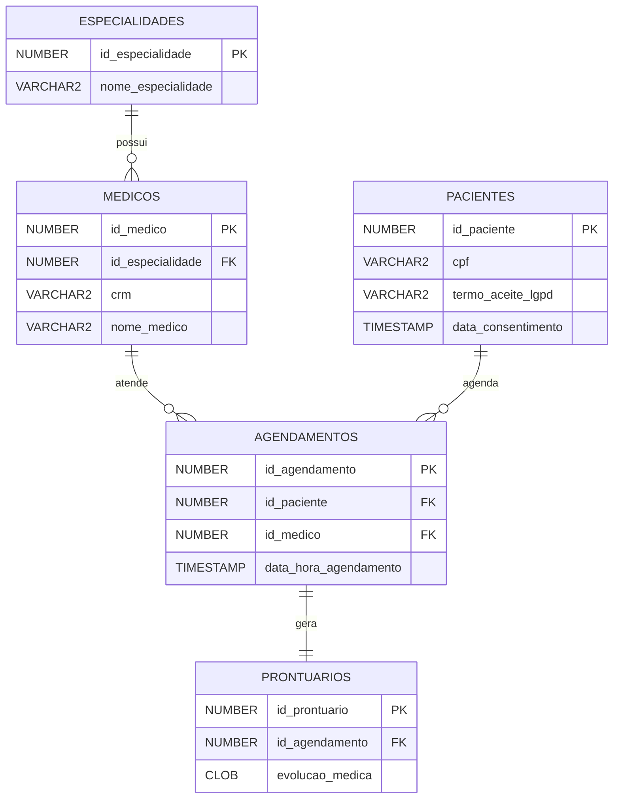

# Modelo Conceitual e Logico - Sistema Clinica Medica

## 1. Visao Geral da Arquitetura de Dados
O modelo de dados foi concebido para atender aos requisitos operacionais de agendamento e atendimento clinico de uma instituicao de saude, incorporando desde o nivel conceitual as diretrizes de integridade relacional e a conformidade com a Lei Geral de Protecao de Dados (LGPD - Lei 13.709/2018).

## 2. Diagrama Entidade-Relacionamento (DER Logico)

## 3. Analise Tecnica de Cardinalidades e Comportamento de Chaves Estrangeiras

### 3.1. ESPECIALIDADES (1) -> (N) MEDICOS
* **Descricao do Relacionamento:** Uma especialidade medica pode estar associada a varios medicos cadastrados no corpo clinico. Cada medico esta vinculado a uma unica especialidade principal de atuacao neste modelo.
* **Comportamento da Chave Estrangeira (FK):** A coluna `ID_ESPECIALIDADE` reside como Chave Estrangeira (FK) na tabela dependente `MEDICOS`, referenciando a Chave Primaria (PK) `ESPECIALIDADES(ID_ESPECIALIDADE)`.
* **Regra de Integridade:** `ON DELETE RESTRICT` (ou `NO ACTION`). Nao e permitido remover uma especialidade que possua profissionais vinculados ativos.

### 3.2. MEDICOS (1) -> (N) AGENDAMENTOS
* **Descricao do Relacionamento:** Um medico pode atender multiplos agendamentos ao longo de sua escala de trabalho. No entanto, cada registro de agendamento esta atribuido estritamente a um unico medico responsavel.
* **Comportamento da Chave Estrangeira (FK):** A coluna `ID_MEDICO` e alocada como FK na tabela `AGENDAMENTOS`, referenciando `MEDICOS(ID_MEDICO)`.
* **Regra de Integridade:** Exige presenca obrigatoria (`NOT NULL`) no ato da gravacao da consulta, impedindo sessoes sem profissional designado.

### 3.3. PACIENTES (1) -> (N) AGENDAMENTOS
* **Descricao do Relacionamento:** Um paciente pode realizar diversos agendamentos ao longo de sua jornada de saude na instituicao. Todavia, cada agendamento pertence unicamente a um paciente titular.
* **Comportamento da Chave Estrangeira (FK):** A coluna `ID_PACIENTE` e alocada como FK na tabela `AGENDAMENTOS`, referenciando `PACIENTES(ID_PACIENTE)`.
* **Regra de Integridade:** Mantem o vinculo juridico e operacional com o titular cadastrado. Em consonancia com a LGPD, o agendamento referencia o paciente sem replicar dados identificadores (minimizacao de dados).

### 3.4. AGENDAMENTOS (1) -> (1) PRONTUARIOS
* **Descricao do Relacionamento:** Cada agendamento efetivado resulta em no maximo um unico registro de prontuario medico correspondente. Um prontuario existe exclusivamente em funcao de um agendamento previo realizado.
* **Comportamento da Chave Estrangeira (FK):** A coluna `ID_AGENDAMENTO` e posicionada como FK na tabela `PRONTUARIOS`, referenciando `AGENDAMENTOS(ID_AGENDAMENTO)`.
* **Implementacao da Cardinalidade Estrita 1:1:** Para impor que um agendamento nunca tenha mais de um prontuario associado no nivel relacional, a coluna `ID_AGENDAMENTO` recebe simultaneamente as constraints `NOT NULL` e `UNIQUE`. Como alternativa de alta coesao, `ID_AGENDAMENTO` pode atuar cumulativamente como PK e FK na tabela `PRONTUARIOS`.

## 4. Preceitos de Seguranca e LGPD na Modelagem
* **Minimizacao de Dados (Art. 6, III da LGPD):** Coleta restrita aos campos estritamente necessarios para a prestacao do servico de saude.
* **Segregacao de Papeis e Dados Sensiveis (Art. 5, II e Art. 11 da LGPD):** Dados sensiveis de saude ficam isolados na entidade `PRONTUARIOS`, enquanto dados cadastrais permanecem em `PACIENTES`.
* **Rastreabilidade e Auditoria:** Vinculacao de consentimento explicito registrado com carimbo temporal no cadastro do paciente.
