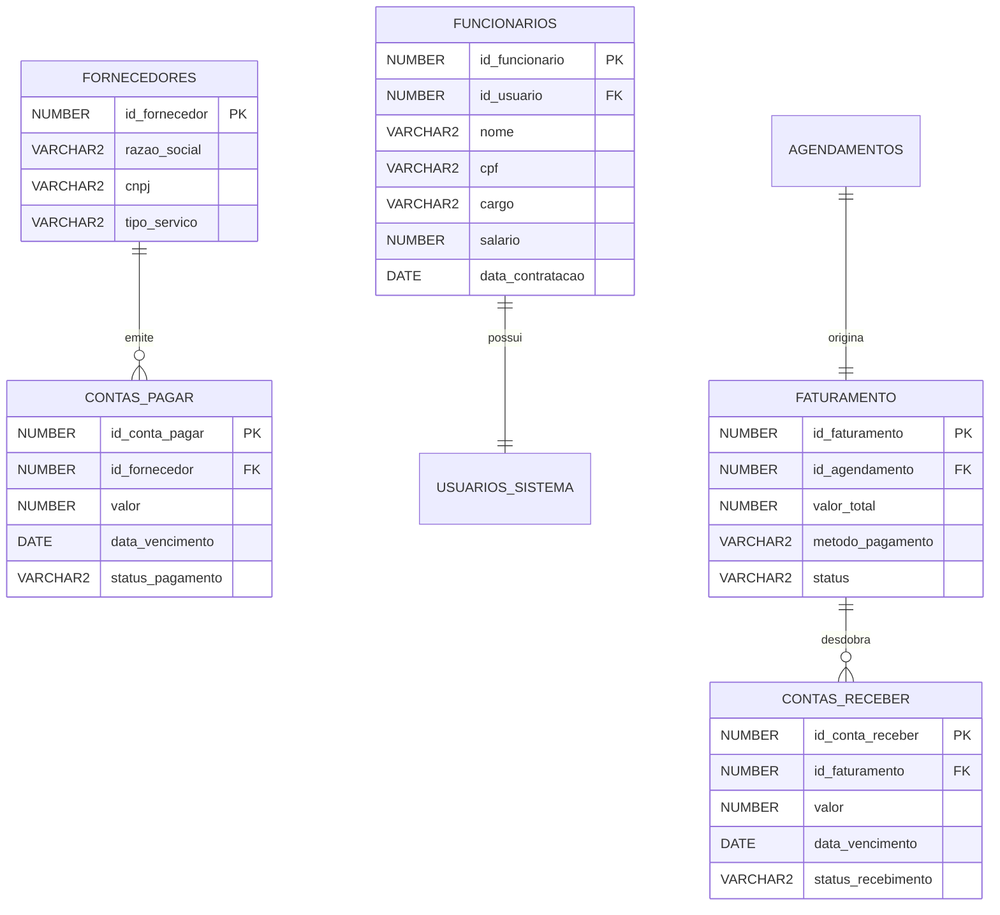

# Modelo de Dados Back-Office (Mini-ERP): Financeiro, Recursos Humanos e Fornecedores

## 1. Visao Geral da Arquitetura de Back-Office
A camada de Back-Office da Clinica Medica foi modelada para estruturar o fluxo financeiro e a gestao de pessoas (RH), conectando o atendimento clinico ponta a ponta: desde a realizacao da consulta ate a quitacao de despesas com fornecedores e o faturamento das receitas originadas dos pacientes ou operadoras de saude (convenios).

---

## 2. Diagrama Entidade-Relacionamento do Back-Office (DER)

---

## 3. Analise Tecnica de Cardinalidades e Chaves Estrangeiras (FK)

### 3.1. FORNECEDORES (1) -> (N) CONTAS_PAGAR
* **Descricao:** Um fornecedor homologado pode possuir multiplos titulos de despesa, faturas de insumos hospitalares ou contratos de manutencao ao longo do tempo.
* **Comportamento da FK:** A coluna `ID_FORNECEDOR` reside na tabela `CONTAS_PAGAR`, referenciando `FORNECEDORES(ID_FORNECEDOR)`. A integridade impede o lancamento de despesas vinculadas a fornecedores inexistentes ou nao cadastrados.

### 3.2. FUNCIONARIOS (1) -> (1) USUARIOS_SISTEMA
* **Descricao:** Cada colaborador operacional da clinica fisica possui exatamente uma credencial corporativa para operacao dos modulos no Oracle APEX.
* **Comportamento da FK:** A coluna `ID_USUARIO` e alocada na tabela `FUNCIONARIOS`, referenciando `USUARIOS_SISTEMA(ID_USUARIO)`. Para assegurar a relacao estrita 1:1, a coluna possui constraints cumulativas `NOT NULL` e `UNIQUE`, impedindo que multiplos colaboradores compartilhem a mesma conta ou que uma conta seja associada a multiplos funcionarios.

### 3.3. AGENDAMENTOS (1) -> (1) FATURAMENTO
* **Descricao:** A conclusao de uma consulta medica gera uma cobranca financeira formal referente aos honorarios e procedimentos executados.
* **Comportamento da FK:** A coluna `ID_AGENDAMENTO` e posicionada em `FATURAMENTO`, referenciando `AGENDAMENTOS(ID_AGENDAMENTO)`. A unicidade e garantida por uma constraint `UNIQUE` e `NOT NULL`, assegurando que um agendamento nunca seja faturado em duplicidade.

### 3.4. FATURAMENTO (1) -> (N) CONTAS_RECEBER
* **Descricao:** O faturamento de uma consulta pode ser quitado integralmente no ato (1:1) ou desdobrado em varias parcelas de cartao ou lotes de reembolso de operadoras de planos de saude (1:N).
* **Comportamento da FK:** A coluna `ID_FATURAMENTO` reside na tabela dependente `CONTAS_RECEBER`, referenciando `FATURAMENTO(ID_FATURAMENTO)`. Isso permite acompanhar individualmente a liquidacao de cada parcela e eventuais glosas de operadoras.

---

## 4. Consumo nos Dashboards Analiticos do Oracle APEX

A modelagem de Back-Office fornece os agregadores necessarios para alimentar paineis gerenciais em tempo real desenvolvidos no Oracle APEX:

* **Dashboard de Demonstrativo de Resultados (DRE) / Receita vs Despesa:**
  * Cruzamento SQL entre as tabelas `CONTAS_RECEBER` (entradas liquidadas e a liquidar) e `CONTAS_PAGAR` (despesas operacionais e folha de pagamento via `FUNCIONARIOS`), permitindo calcular margem de lucro, EBITDA e saldo de caixa projetado.
* **Dashboard de Produtividade e Ticket Medio:**
  * Agrupamento de `FATURAMENTO` cruzado com `AGENDAMENTOS`, `MEDICOS` e `ESPECIALIDADES`, mensurando receita gerada por profissional, ocupacao de agenda e custo medio por atendimento.
* **Dashboard de Inadimplencia e Ciclo de Recebimento de Convenios:**
  * Metricas de Aging List baseadas em `CONTAS_RECEBER.DATA_VENCIMENTO` e `STATUS_RECEBIMENTO`, identificando gargalos de fluxo de caixa gerados por glosas de planos de saude.

---

## 5. Diretrizes de LGPD no RH
Os dados cadastrais e financeiros de colaboradores presentes em `FUNCIONARIOS` (especialmente `CPF` e `SALARIO`) sao classificados como dados pessoais e dados confidenciais corporativos. O acesso a esses campos e restrito exclusivamente a usuarios vinculados ao perfil `ADMIN`, sofrendo mascaramento integral para os demais usuarios atraves de politicas do Oracle Data Redaction.
