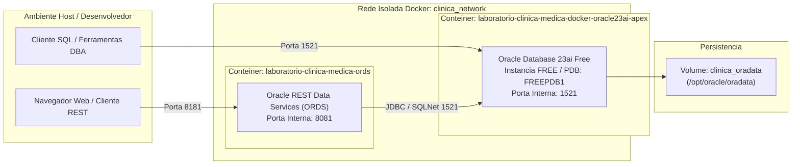

# Arquitetura de Integracao: Oracle 23ai e Oracle REST Data Services (ORDS)

## 1. Visao Geral da Arquitetura Desacoplada

O ecossistema do laboratorio da Clinica Medica adota uma arquitetura em dois conteineres independentes e comunicantes atraves de uma rede bridge isolada (`clinica_network`):

1. **Camada de Dados (Motor Relacional)**: Servico `db_clinica` executando o Oracle Database 23ai Free.
2. **Camada de Apresentacao e REST**: Servico `ords_clinica` executando a imagem oficial do Oracle REST Data Services (ORDS).

Essa segregacao fisica em conteineres distintos viabiliza alta performance, manutencao granular e desacoplamento de responsabilidades tecnicas entre persistencia transacional e intermediacao HTTP/REST.

---

## 2. Segregacao de Papeis e Responsabilidades

### 2.1. Motor Relacional (`db_clinica`)
* **Nome do Conteiner**: `laboratorio-clinica-medica-docker-oracle23ai-apex`
* **Imagem Base**: `gvenzl/oracle-free:23.3-full`
* **Funcao Primaria**: Motor de banco de dados transacional e analitico.
* **Escopo Operacional**:
  * Execucao do kernel relacional, processamento de queries SQL e rotinas PL/SQL.
  * Gerenciamento de buffers de memoria SGA/PGA, cache de dados e controle de concorrencia ACID.
  * Hospedagem do catalogo de dados e do Pluggable Database `FREEPDB1`.
  * Persistencia das estruturas de tablespace no volume nomeado `clinica_oradata`.
* **Portas Expostas**:
  * `1521:1521` (TNS Listener para conexoes administrativas e ferramentas de desenvolvimento).
  * `8080:8080` (Porta legada/reserva de servicos auxiliares).

### 2.2. Camada de Apresentacao e REST (`ords_clinica`)
* **Nome do Conteiner**: `laboratorio-clinica-medica-ords`
* **Imagem Base**: `container-registry.oracle.com/database/ords:latest`
* **Funcao Primaria**: Servidor de aplicacao intermediario para Oracle APEX e servicos RESTful.
* **Escopo Operacional**:
  * Servir a interface web e renderizacao das aplicacoes do Oracle APEX.
  * Distribuicao e cache de assets estaticos de frontend (JavaScript, CSS, imagens).
  * Traducao de requisicoes HTTP/JSON em chamadas JDBC otimizadas via pool de conexoes.
  * Exposicao segura de endpoints REST mapeados diretamente para objetos do schema `CLINICA_MEDICA`.
* **Portas Expostas**:
  * `8181:8081` (Mapeamento da porta 8181 do host para o listener HTTP interno do ORDS na 8081).

---

## 3. Beneficios de Isolamento e Performance

1. **Segregacao de Recursos de Computacao**:
   * O overhead de tratamento de sessoes HTTP, parsing de JSON e entrega de arquivos estaticos e absorvido pelo conteiner do ORDS, impedindo degradacao de CPU e memoria na instancia do Oracle Database.
2. **Seguranca Operacional**:
   * O banco de dados nao precisa expor seu listener web diretamente a redes externas; a comunicacao entre o ORDS e o PDB ocorre internamente pela rede `clinica_network` usando o hostname DNS interno `db_clinica`.
3. **Independencia de Ciclo de Vida**:
   * Atualizacoes de versao, patches de seguranca do servidor web e reinicializacoes do ORDS podem ser realizados sem interromper transacoes ativas no banco de dados.
4. **Gerenciamento de Pools de Conexao**:
   * O ORDS mantem pools de conexao JDBC reutilizaveis apontando para o servico `FREEPDB1`, reduzindo o custo de conexao/desconexao no banco.

---

## 4. Parametrizacao de Integracao

As variaveis de ambiente injetadas no servico `ords_clinica` estabelecem o direcionamento automatizado:

| Variavel | Valor | Finalidade |
| :--- | :--- | :--- |
| `ORACLE_HOST` | `db_clinica` | Endereco DNS do servico do banco na rede bridge Docker |
| `ORACLE_PORT` | `1521` | Porta de escuta do TNS Listener |
| `ORACLE_SERVICE` | `FREEPDB1` | Nome do Pluggable Database de destino |
| `ORACLE_PWD` | `Clinica_2026_Admin!` | Credencial administrativa para validacao do pool |
| `ORDS_PWD` | `Clinica_2026_Admin!` | Senha de administracao das configuracoes do ORDS |

---

## 5. Credenciais de Acesso ao Laboratório APEX

Informacoes de autenticacao e conectividade para o ambiente de desenvolvimento do Oracle APEX:

* **URL de Desenvolvimento:** http://localhost:8181/ords/
* **Workspace:** WS_CLINICA_MEDICA
* **Schema Associado:** CLINICA_MEDICA
* **Username:** admin_apex
* **Password:** Clinica_2026_Admin!

> [!NOTE]
> As 13 tabelas do backend foram reconhecidas com sucesso no SQL Workshop do APEX para manipulacao direta e construcao de aplicacoes.
